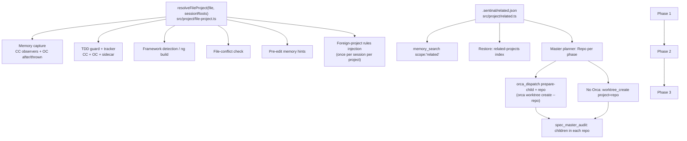

# Cross-Project Scope Master Plan

Created: 2026-11-05
Status: IN_PROGRESS
Approved: Yes
Iterations: 1
Worktree: No
Type: Master

## Goal

When one session (typically a central "ops" project) works on files in other Sentinal projects,
each file is handled under **its own** project: memory capture and recall, TDD gating, framework
checks and that project's rules. An ops project can declare its related projects, and a master
plan can run each phase in a worktree of the repo it changes — through Orca workers when Orca is
available, sequentially otherwise.

## Problem (verified 2026-11-05)

Almost every Sentinal mechanism is keyed on the **session cwd**, never on the edited file:

| Mechanism | Today | Evidence |
| --- | --- | --- |
| Auto-captured memories | session project | `src/hooks/memory-observer.ts:87`, `tool-failure-observer.ts:182`, OC `sentinal.ts:942,976,556` |
| Pre-edit memory hints | session project (OC output only reaches the TUI log) | `src/hooks/pre-edit-guide.ts:56`, `sentinal-helpers.ts:187-218`, `sentinal.ts:1127` |
| TDD guard "active plan?" | session project; state keyed by file | `src/hooks/tdd-guard.ts:71`, `tdd-routes.ts:250-255` |
| TDD tracker writes | session project (re-keys the file's row) | `src/hooks/tdd-tracker.ts:84-169`, `src/memory/store.ts:211` |
| Framework detection / `ng build` | session cwd, no walk-up | `src/hooks/file-checker.ts:57-59`, `src/checkers/detect.ts:47`, OC `sentinal.ts:768` |
| File-conflict warning | session project | `src/cli/commands/hook.ts:166-183`, `src/session/conflict.ts:88` |
| Project rules | session checkout only | `install-project-setup.ts:67` symlink, OC relative `instructions` glob |
| Orca child worktrees | always the coordinator's repo (no `--repo`) | `src/orca/dispatch.ts:174-211`, `src/orca/mcp-tools.ts:307-319` |
| Master audit | children only next to the master | `src/spec/master-audit.ts:183` |

`resolveProjectIdentity(filePath)` silently returns the file itself (it runs git with the file as
cwd and falls back to `realpath`), so the fix cannot simply pass a file path.

## Architecture

### The resolver (Phase 1, used by every later phase)

`resolveFileProject(filePath, session)` → `{ identity, workspace, foreign }`:

1. Walk up from `dirname(filePath)` to the nearest **existing** directory (a Write may create a
   new directory), `realpath` it, then walk up to the nearest ancestor containing a `.git` entry
   (file or directory — linked worktrees and submodules use a `.git` file). Filesystem only.
2. **Compare canonical paths only.** If `realpath(repoTop) === realpath(session.workspace)`,
   return the session roots with `foreign: false` — no spawn on the common path. (Plain string
   comparison would misfire on macOS `/var` → `/private/var` and symlinked checkouts, making every
   edit "foreign".)
3. No `.git` found (file outside any repo) → session roots, `foreign: false` (today's behaviour).
4. Otherwise `identity = resolveProjectIdentity(repoTop)` (one git spawn, memoized in-process via
   `canonicalProjectKey`), `workspace = repoTop`, and **`foreign = identity !== session.identity`**.
   A file in another worktree of the **same** repo (e.g. an Orca child worktree) is therefore not
   foreign: same storage key, but its own `workspace` for framework detection and plan lookup.
5. Submodules and nested repos are their own repos (decision 1) → foreign. A dotfiles repo at
   `$HOME` is a repo too; files under it resolve to it (documented, not special-cased).

The foreign-path spawn is accepted: in Claude Code each hook is a fresh process, so the memo
only helps within one invocation, but only edits **outside** the session repo pay it (Phase 1
measures it with `hyperfine`). Deriving identity from `.git`/`commondir` without git is
explicitly rejected — memory #1363 records that `dirname(--git-common-dir)` is wrong for
`--separate-git-dir` and bare layouts.

A foreign project is **any other git repo** (decided), whether or not it has a `.sentinal/` dir;
rules are only injected when `<workspace>/.sentinal/rules/*.md` exists. The module stays free of
`bun:sqlite` (it is bundled into the OpenCode plugin). The identity/workspace rule
(`.sentinal/rules/sentinal-project.md` § Project Identity vs Workspace Root) applies unchanged:
identity → storage keys only, workspace → filesystem reads/writes only.

## Context (applies to every phase)

- **Decisions taken with the user (2026-11-05):**
  1. Another project = any other git repo.
  2. Foreign rules: inject the full `.sentinal/rules/*.md` once per session per project, size-capped,
     with a pointer list for anything cut; on **edits only** (no new sync hook on Read).
  3. Related projects live in a committed `.sentinal/related.json`.
  4. TDD guard enforces when **either** the file's project **or** the session project has an
     active `/spec` plan.
  5. Related memory: `memory_search` gains an opt-in `scope: "related"`; session-start restore
     keeps the session project's memories and adds a one-line index of related projects.
  6. Cross-repo child plans live **in the target repo** (written into that phase's worktree), so
     the worker runs `/spec` natively there; the master records `Repo:` per phase.
  7. All three phases are in scope.
- **Cross-phase rules decided at master level (from plan review):**
  - **Data keys.** Every per-file row (observation, TDD row, conflict record) is written with the
    **file's** identity, so sessions in A and in B agree. Observations also carry
    `metadata.sessionProject` (the session identity) so the originating project can still list
    what it captured. Existing rows are **not migrated**; old ops-keyed memories stay under ops.
  - **TDD tracker.** Test runs are mapped per project: each named test file/dir is resolved with
    `resolveFileProject` and that project's rows are transitioned; a run naming no files is
    project-wide for the project of its **effective cwd** (`cd` target or OC `workdir`), not the
    session's. `testRunScope` must expose that effective cwd.
  - **Conflict check.** Both the edit record and the query use the file's identity.
  - **Old sidecars.** New request fields are optional. An old sidecar receiving a foreign
    identity simply stores it (write routes already canonicalize); a missing multi-project search
    falls back to one request per project.
  - **Rules-injection state.** CC: a session-keyed marker file under the **session** workspace
    (`.sentinal/injected-rules.json`, gitignored), cleared on `SessionStart(compact)` and
    `SessionEnd` so rules are re-injected after compaction. OC: in-memory set, re-pushed in
    `system.transform` every turn under a **total** cap across all foreign projects (per-project
    cap plus overall cap; overflow becomes a pointer list).
  - **Cross-repo child linkage** (detailed in Phase 3). A foreign phase's child plan is written
    at planning time as a **seed** in the master's `docs/plans/` with `Repo:` (and `Base:`); at
    execution its copy is committed into the phase worktree and the seed records `Location:`
    (absolute while running, relative to `Repo:` after the merge). `spec_master_audit` follows
    only the seed's `Location:` and checks the copy's `Parent:` — it never scans another repo by
    slug (a same-named plan there must not be mistaken for a child). The copy's `Master:` is the
    master's repo-relative path, informational only.
  - **Orca `--repo` / `--no-parent` are unverified** (unused in `src/orca`); Phase 3's first task
    is a live CLI check recorded in the `sentinal-orca-cli` skill.
  - **OC `apply_patch`.** Phase 1 extracts paths from `*** Add File:` / `*** Update File:` /
    `*** Delete File:` lines of `patchText` and runs the per-file checks for each.
  - **Undeclared foreign projects.** `scope: "related"` covers `related.json`; the session-start
    index additionally lists foreign projects this project's sessions captured memories for
    (via `metadata.sessionProject`) with a hint to add them to `related.json`.
- **Dual target.** Every behaviour lands in Claude Code hooks (`src/hooks/`, fresh process per
  hook — persistent per-session state must be on disk or in the sidecar) and the OpenCode plugin
  (`targets/opencode/plugins/sentinal.ts`, long-lived — in-memory state is fine). OC model-visible
  context must go through `experimental.chat.system.transform` (re-pushed every turn); the
  `tool.execute.before` "hint" path only reaches the TUI log.
- **OC `apply_patch` gap:** its only arg is `patchText`; it is in no tool list today
  (`sentinal.ts:724-733`, `:293`) — handled in Phase 1 as above.
- **Hot paths.** tdd-guard and pre-edit-guide are synchronous PreToolUse hooks. The resolver's
  common path must not spawn; foreign paths may spawn git once (memoized in-process).
- **Sidecar compatibility.** New request fields are optional; an old sidecar ignores them.
- **Parity baselines.** `spec-master-plan.diff` must stay 0 bytes; regenerating baselines rewrites
  the whole fixture dir — only one phase may touch `targets/*/commands|skills|rules` at a time
  (`sentinal-parity-baselines` skill). Phases are sequential partly for this reason.
- **File-length limits** (400 warn / 600 block, tests exempt; plugin file exempt) and TDD guard
  apply to this repo's own `src/**`.
- Counts in `.sentinal/rules/sentinal-mcp-servers.md` and `README.md` must be updated if a tool is
  added (none planned: `scope` is a new param on `memory_search`, `repo` a new field on
  `orca_dispatch` tasks).

## Waves

**Wave 1** — Foundation: Phase 1 (resolver + per-edit wiring). Everything else consumes it.
**Wave 2** — Context: Phase 2 (related projects, foreign rules injection, related memory search).
Depends on the resolver to know which project a file belongs to.
**Wave 3** — Orchestration: Phase 3 (cross-repo master plans, Orca `--repo`, audit across repos).
Uses `related.json` for repo selection and edits shipped skills/commands, which Phase 2 also edits
(shared parity fixture dir) — so it cannot run in parallel with Phase 2.

## Phases

| Phase | Wave | Title | Objective | Dependencies |
| ----- | ---- | ----- | --------- | ------------ |
| 1 | 1 | File-project resolver + per-edit wiring | `resolveFileProject`; memory capture, pre-edit hints, TDD guard/tracker, framework detection and conflict check use the file's project on both targets | None |
| 2 | 2 | Related projects + foreign context | `.sentinal/related.json`; inject a foreign project's rules once per session on first edit; `memory_search scope:"related"`; restore index; shipped rule guidance | Phase 1 |
| 3 | 3 | Cross-repo master plans | `Repo:` per phase; `orca_dispatch` prepare-child in another repo (`--repo`); child stubs in the target repo's worktree; per-repo setup/merge; `spec_master_audit` across repos; non-Orca fallback | Phases 1, 2 |

Child plans:

- Phase 1: `docs/plans/2026-11-05-cross-project-scope-phase-1.md`
- Phase 2: `docs/plans/2026-11-05-cross-project-scope-phase-2.md`
- Phase 3: `docs/plans/2026-11-05-cross-project-scope-phase-3.md`

## Risks

| Risk | Likelihood | Impact | Mitigation |
| --- | --- | --- | --- |
| Resolver adds latency to sync PreToolUse hooks | Med | High | fs-only walk-up; git only for foreign repos; measure with `hyperfine` (Phase 1 DoD) |
| Memories re-keyed to sibling projects disappear from the ops user's view | Med | Med | Phase 2 `scope:"related"` search + restore index; observations keep `metadata.sessionProject` |
| TDD rows flip between projects across sessions | Med | Med | Rows always written with the **file's** project, so every session agrees |
| Rules injection floods context | Med | Med | Once per session per project, size cap, pointer list for overflow |
| Orca `--repo` behaves differently from same-repo children (setup, parent link) | Med | High | Phase 3 verifies against the live Orca CLI and records it in `sentinal-orca-cli` skill; `--no-parent` for foreign repos |
| Child plan in another repo invisible to audit before merge | Med | Med | Audit reads the phase worktree path while unmerged, the repo's `docs/plans` after merge |

## Definition of Done (master)

- [ ] All three child plans VERIFIED (`spec_master_audit` PASS)
- [ ] From a session in repo A, editing a file in sibling repo B: captured memories, TDD rows and
      the conflict check are keyed to B's identity (test on both targets)
- [ ] TDD guard blocks an edit in B when only B has an active plan, and when only A has one
- [ ] First edit in B injects B's `.sentinal/rules` once (CC additionalContext, OC system prompt)
- [ ] `memory_search({scope: "related"})` from A returns B's observations when B is in A's
      `.sentinal/related.json`
- [ ] A cross-repo master plan places a phase's worktree and child plan in B (Orca and non-Orca),
      merges into B's base branch, and `spec_master_audit` finds the child
- [ ] Full suite, typecheck, plugin typecheck, lint, format:check green; README and
      `.sentinal/rules/sentinal-*.md` updated

## Progress Tracking

- [x] Phase 1: File-project resolver + per-edit wiring (Wave 1) — VERIFIED
- [ ] Phase 2: Related projects + foreign context (Wave 2) — PENDING
- [ ] Phase 3: Cross-repo master plans (Wave 3) — PENDING

**Total Phases:** 3 | **Completed:** 1 | **Remaining:** 2
